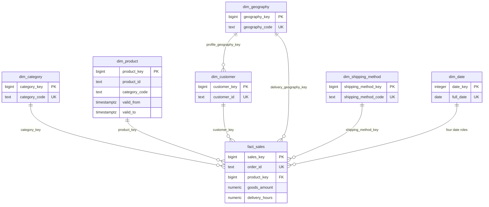
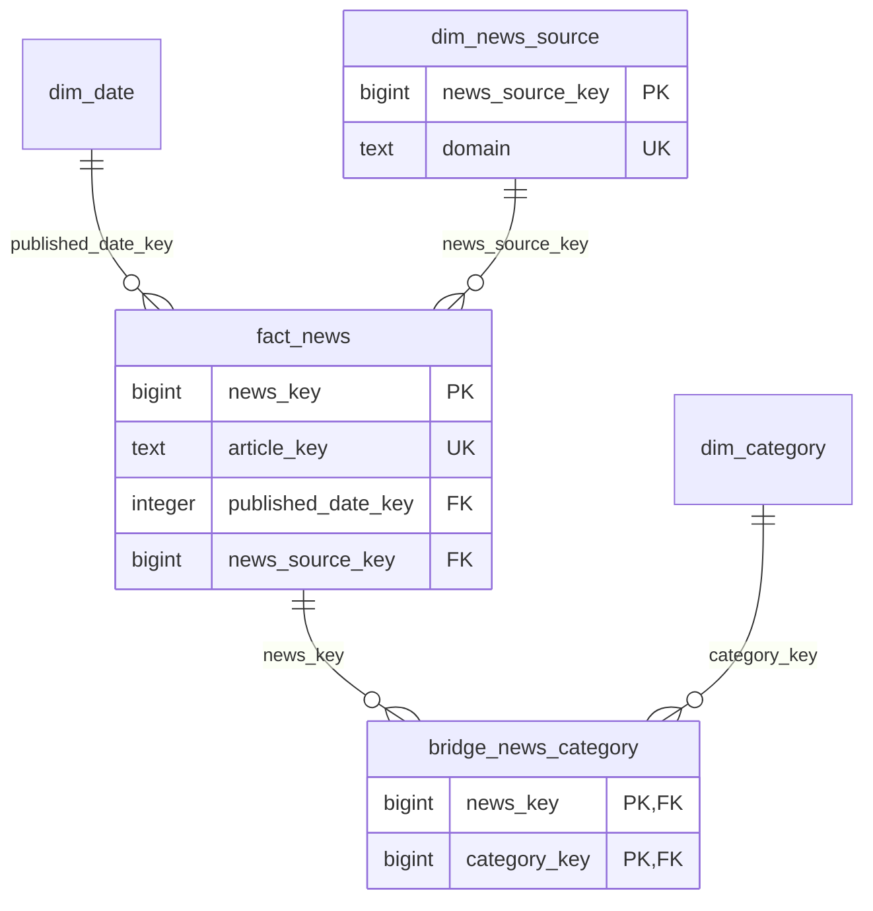

# Lược đồ quan hệ kho LAK

## Bán hàng

Bốn vai trò cùng tham chiếu dim_date: packed_date_key, dispatched_date_key,
expected_date_key và received_date_key. Có key 0 để biểu diễn chưa biết.
Một product_id có nhiều phiên bản, fact chỉ trỏ một product_key cụ thể.

## Tin tức

dim_date và dim_category là các chiều dùng chung giữa hai sơ đồ, không phải
hai bảng sao chép. Bridge cho phép một bài nhiều danh mục. Fact bán hàng
tham chiếu trực tiếp các chiều để truy vấn hình sao. category_code được giữ
trên version sản phẩm để biết cách gán category_key của fact tại lúc chiếu.

Các cột đầy đủ, constraint và chỉ mục nằm trong SQL. Hai sơ đồ chỉ thể hiện
quan hệ phân tích; raw/staging/audit có hợp đồng truy vết riêng.
